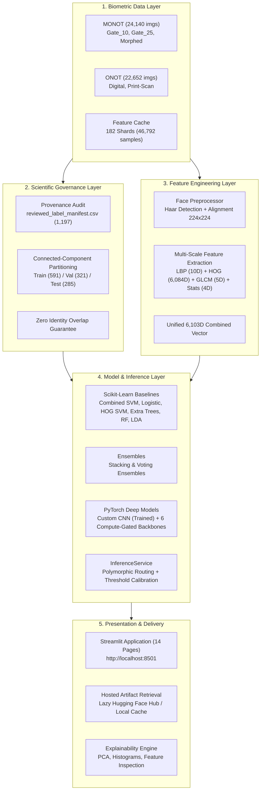

# MorphGuard V3.0 — System Architecture

## 1. System Overview
MorphGuard is an experimental biometric research platform designed to investigate facial morph attack detection (MAD), multi-scale texture extraction, and deep neural architectures under strict leakage prevention protocols.

## 2. Directory Hierarchy
- `app/`: Multi-page Streamlit application (14 interactive research pages).
  - `pages/`: 14 pages including Face Morph Analysis, Model Comparison, Dataset Explorer, Model Insights, Research Experiments.
  - `components/`: UI components, theme manager, data loaders.
- `src/morphguard/`: Production-grade core Python library.
  - `preprocessing/`: Haar cascade detection, blur variance (sharpness), contrast, and alignment.
  - `feature_extraction/`: Extractors for LBP, HOG, GLCM, and statistical descriptors.
  - `classification/`: Model factories and PyTorch / Scikit-learn definitions.
  - `inference/`: `InferenceService`, polymorphic adapters (`FeatureModelAdapter`, `PyTorchModelAdapter`), and hosted model resolution.
  - `dataset/`: Manifest schemas, label validation, and connected-component grouping.
- `data/`:
  - `cache/image_features/`: 182 compressed `.npz` shards storing 46,792 feature records.
  - `manifests/`: `annotation_inventory.csv` (46,792 records) and `reviewed_label_manifest.csv` (1,197 records).
- `models/`:
  - `trained/`: Trained `.joblib` model artifacts.
  - `checkpoints/`: Trained PyTorch checkpoints (`custom_cnn.pt`).
  - `metadata/`: Individual architecture JSON specs and `model_registry.json` tracking 21 architectures.
- `reports/`:
  - `dataset_inventory.csv`, `label_distribution.csv`, `unlabelled_samples.csv`, `duplicate_audit.csv`, `split_assignments.csv`.
  - `split_leakage_audit.md`, `dataset_quality_report.md`, `label_provenance_report.md`.
  - `predictions/`: Raw test predictions for all 15 trained models.
- `scripts/`: Modular automation tools for processing, training, calibration, validation, and testing.
